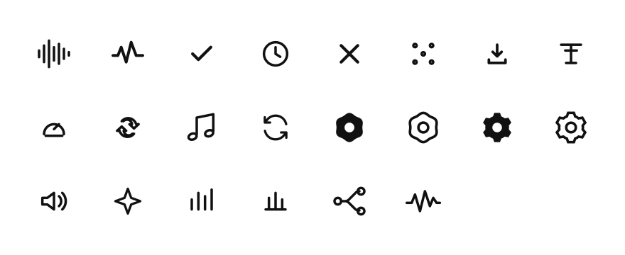

# Tzeroky Icons



A small collection of original, lightweight outline icons for personal projects.

## Six-tooth settings family

All four gear variants share the same six-tooth, 60-degree symmetric geometry, a circular center opening, and a 24 × 24 coordinate grid.

| Icon | Corners | Style |
| --- | --- | --- |
| [`settings-rounded.svg`](settings-rounded.svg) | Soft-wave rounded | Outline |
| [`settings-rounded-solid.svg`](settings-rounded-solid.svg) | Soft-wave rounded | Filled |
| [`settings-sharp.svg`](settings-sharp.svg) | Angular | Outline |
| [`settings-sharp-solid.svg`](settings-sharp-solid.svg) | Angular | Filled |

Legacy aliases are preserved: `settings.svg` matches `settings-sharp.svg`, and `settings-solid.svg` matches `settings-rounded-solid.svg`. All six SVG files are independent; no external references are needed.

## Preview

Open [`index.html`](index.html) in a browser to browse the icon set. Each icon links to its standalone SVG source. The four settings variants appear side by side. The README overview shows all unique icons on white, without borders or labels.

### Regenerate the README icon grid

From the repository root:

```sh
node scripts/generate-preview.mjs
```

The generator uses only Node.js built-ins, discovers root-level SVG icons, excludes the two legacy settings aliases, and updates `assets/icon-overview.svg`. It defaults to eight columns. To choose another layout, run `node scripts/generate-preview.mjs --columns 6`. Commit the regenerated SVG whenever icons change.

## Use

SVG files use a `24 × 24` view box, transparent backgrounds, and `currentColor` strokes or fills. You can use them as standalone images or inline them in HTML:

```html
<svg aria-hidden="true" width="24" height="24">
  <use href="music-note.svg#icon"></use>
</svg>
```

## License

Released under the MIT License. See [`LICENSE`](LICENSE).
